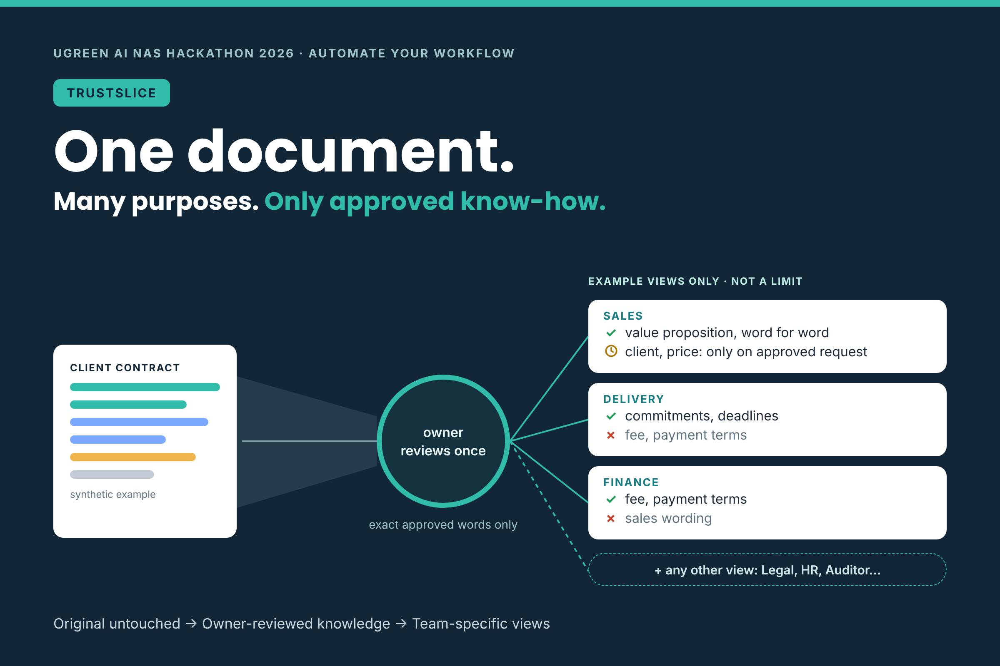
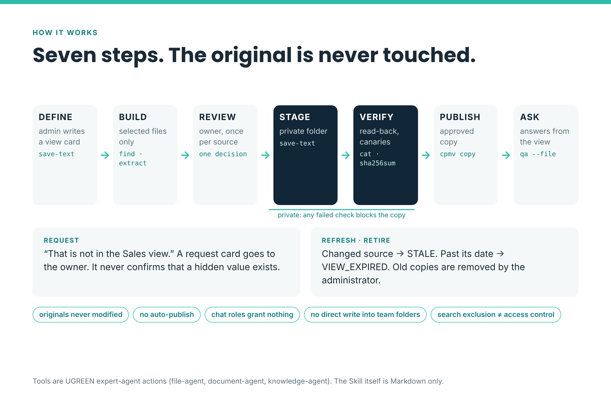

# TrustSlice – Confidential Knowledge Views

**Share the know-how. Not the whole document.**

TrustSlice is a Markdown-only Uliya Skill for UGREEN AI NAS. It turns one mixed business document (a proposal, an agreement, meeting notes, a report) into owner-approved, word-for-word knowledge views for different teams. A team then asks Uliya questions and gets answers only from the view it can already open, with a citation. The original stays untouched in a protected folder.

Entry for the **UGREEN AI NAS Hackathon 2026**, track *Automate Your Workflow*. This is an independent community project, not an official UGREEN product. The Skill's stable identifier is `evidence-lens`, the project's earlier working name.



## The problem in one example

> **Example only, not a limit.** Sales, Delivery and Finance below illustrate one split of a synthetic contract. The administrator defines any views (Legal, HR, Auditor, a single project…), in any number.

| Part of the contract | Sales | Delivery | Finance | + any other view |
|---|---|---|---|---|
| Value proposition | ✓ | ✗ | ✗ | you decide |
| Obligations | ✗ | ✓ | ✗ | you decide |
| Client name | only via an approved request | ✓ | ✓ | you decide |
| Contract price | only via an approved request | ✗ | ✓ | you decide |
| Dates and deadlines | ✗ | ✓ | ✓ | you decide |
| Payment terms | ✗ | ✗ | ✓ | you decide |

NAS folder permissions work per folder and per file. UGOS **Universal Search excluded paths** hide folders from search; they are not access control. Neither can give Sales the value proposition while holding back the price that sits in the same file. Today that means hand-edited copies for each team. TrustSlice builds those views from exact, owner-approved passages.

## How it works



| Step | Who | What happens |
|---|---|---|
| **DEFINE** | Admin | Writes a view card: purpose, audience, included and excluded categories, destination. |
| **BUILD** | Owner | Selected files only: fingerprint, extract, a second read and a leak probe (flags only). |
| **REVIEW** | Owner | One combined preview per source document, all views side by side, flagged passages first. |
| **STAGE** | Skill | Approved text is saved only in a private staging folder. |
| **VERIFY** | Skill | Full read-back equals the approved text, every approved passage is present, no excluded canary appears, the source is unchanged. |
| **PUBLISH** | Skill + platform approval | `ug-filesystem cpmv` copies the verified file into the team folder (`type=copy`, `overwrite=false`), then reads it back again. |
| **ASK** | Team | Answers only from a published view the user can already open; quotes plus the view footer as citation. |
| **REQUEST** | Team | "That is not in the Sales view." A request card goes to the owner; it never confirms that a hidden value exists. |
| **REFRESH / RETIRE** | Owner, admin | Changed source → `STALE`, past its date → `VIEW_EXPIRED`; old copies are removed by the administrator. |

There is no auto-publish mode and no fallback that writes directly into a team folder. A failed check after the copy is reported as `POSSIBLE_EXPOSURE`, never as safe.

The Skill uses only actions from the official UGREEN Skill Kit capability catalog (v2.0.0), delegated to `file-agent`, `document-agent` and `knowledge-agent`. It contains no scripts, binaries or external service calls.

## Status

| Check | Result | Where |
|---|---|---|
| Official Skill Kit checker (`check-skill.mjs`, catalog 2.0.0) | **static-pass**: 0 errors, 0 warnings, 0 info | `tests/static-check-result.json` |
| Offline release-gate simulator | **23/23** mocked cases pass | `tests/release-gate/` |
| Offline fixture integrity | **4/4** PASS, SHA-256 manifest OK | `tests/fixtures/` |
| Run on a real UGREEN AI NAS | **Not yet run.** Security claims stay unverified until the NAS tests in `skill/evidence-lens/references/round2-validation.md` pass. | |

The release-gate simulator is an executable model of the Skill's release rules with mocked expert-agent returns. We checked that it is not vacuous: removing any single rule (canary scan, source re-check before copy, no-overwrite check) makes at least one case fail. It does not test Uliya, the expert agents or NAS permissions.

Open questions for real hardware:

1. Does `extract` return verbatim text?
2. Does a delegated read respect the asking user's folder permissions?
3. Are staged files or published views indexed across roles (`INDEX_LEAK`)?
4. How many platform approval prompts does one release need, and can they be batched?

## Repository layout

```text
skill/evidence-lens/          the Skill: zip this folder and import it (Markdown only)
  SKILL.md
  references/                 view registry, integrity checks, source formats, request
                              workflow, lifecycle, messages, validation, worked example
proposal/                     Round 1 proposal (PDF + Markdown)
devpost/                      Devpost page text
gallery/                      six 3:2 gallery images (2400×1600)
tests/
  static-check-result.json    output of the official checker
  release-gate/               release-gate simulator + its result (offline, mocked)
  synth-contract-01/          synthetic contract with 5 canaries (Sales/Delivery/Finance example)
  fixtures/                   NOT part of the Skill; never upload the oracle to the NAS
    realistic/nas_upload/CKS_SOURCE/   synthetic Hungarian offers, invoices, notes (P041–P043)
    dramatic/nas_upload/CKS_SOURCE/    paired worlds W_RED / W_BLUE: same public offer, different secrets
    optional_formats/                  the same synthetic content as PDF / DOCX
    offline_oracle/                    expected views, canaries, world config (gold answers)
    tools/evaluate.py                  offline scorer
    reports/observations_template.csv  template for recording NAS observations by hand
    SHA256_FIXTURE_MANIFEST.txt
tools/                        scripts that rebuild the proposal PDF and the gallery images
```

`CKS` (Controlled Knowledge Sharing) is the research programme TrustSlice comes from; the fixture folder names keep it.

## Try it

**1. Static check** (Node.js and the official UGREEN Uliya Skill Kit):

```bash
node <path-to>/uliya-skill-kit/scripts/check-skill.mjs skill/evidence-lens
```

**2. Offline tests** (Python 3, standard library only):

```bash
python3 tests/release-gate/release_gate_sim.py
python3 tests/fixtures/tools/evaluate.py --check-fixtures
(cd tests/fixtures && sha256sum -c --quiet SHA256_FIXTURE_MANIFEST.txt && echo OK)
```

**3. On a NAS (test share only):**

1. Zip `skill/evidence-lens/` and import it as a Uliya Skill.
2. Follow *Setup, removal and testing* in `SKILL.md`: protected source, registry and private staging folders, one folder per view, a requests folder, NAS permissions, and Universal Search excluded paths for source, registry and staging.
3. Upload **only** `tests/synth-contract-01/SYNTH-CONTRACT-01.md`, or the files under one `nas_upload/CKS_SOURCE/` folder.
4. Run DEFINE → BUILD → ASK and compare with `skill/evidence-lens/references/worked-example.md`.

**4. Score what the NAS produced** (on your workstation): save the published views as `realistic_sales_view.txt`, `realistic_finance_view.txt`, `w_red_sales_view.txt` and `w_blue_sales_view.txt` in one folder, copy `tests/fixtures/reports/observations_template.csv` to `observations_actual.csv` for manual observations, then:

```bash
python3 tests/fixtures/tools/evaluate.py --observed <folder> --out result.json
```

`NOT_RUN` and `REVIEW` never count as PASS. An offline PASS does not prove NAS security.

> **Do not upload `tests/fixtures/offline_oracle/`, `tests/release-gate/` or any script to the NAS.** The oracle holds the gold answers and canary values; if they are indexed, the leak test is void. Run W_RED and W_BLUE in separate search indexes.

## Data and third-party disclosure

- **All data is synthetic.** Company names, people, amounts and dates are invented; many are deliberate canary strings.
- **Third-party components in the Skill:** none. **External services added:** none. Data flows only through UGREEN's own expert agents and the Uliya models the NAS administrator has authorized.
- The offline test scripts use the Python standard library only and are not part of the Skill. The `tools/` scripts use ReportLab, Playwright and premailer and are only needed to rebuild the PDF and images.
- UGREEN, UGOS and Uliya are trademarks of their owners. This project is not affiliated with or endorsed by UGREEN.

## License

MIT, see [LICENSE](LICENSE).

## Author

Zoltán Fehér, independent researcher, Budapest.
